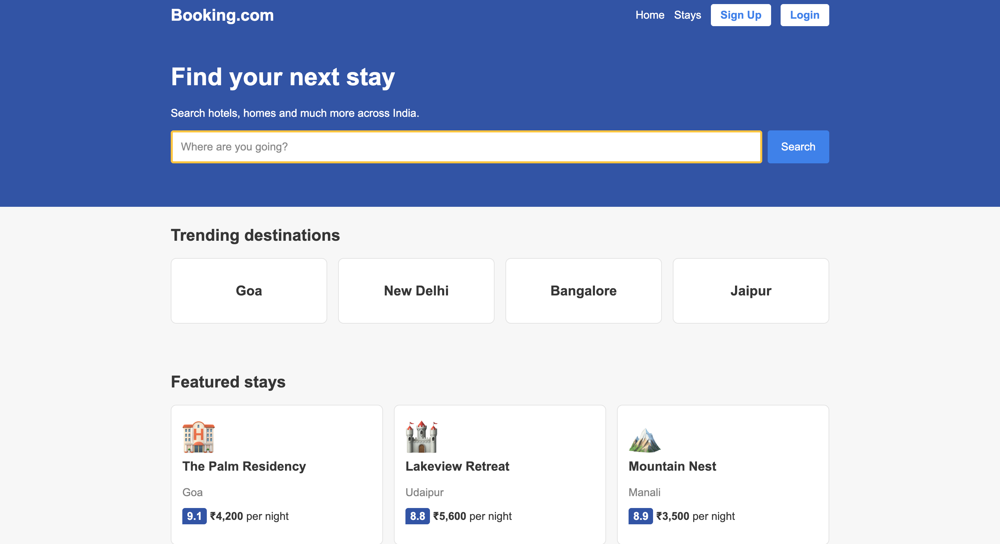
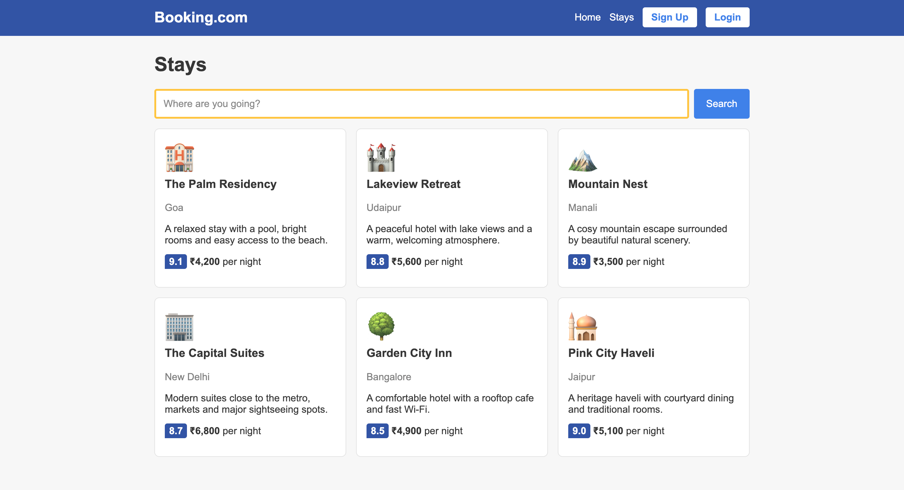
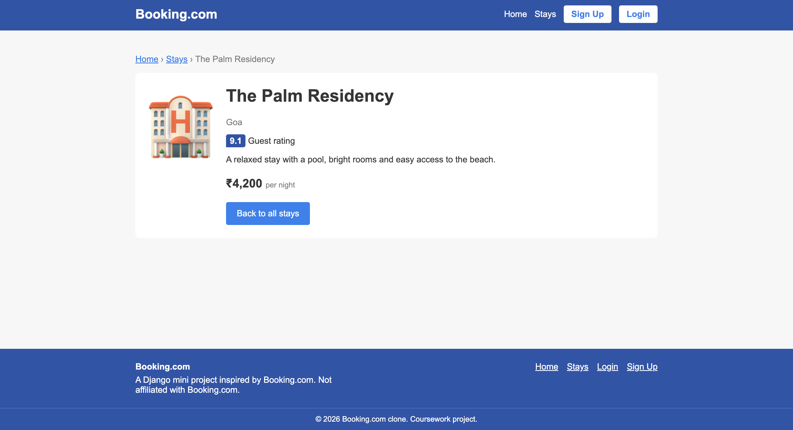
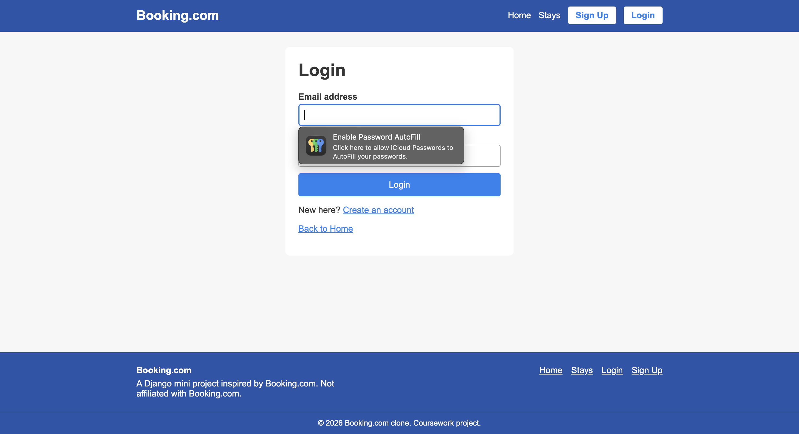
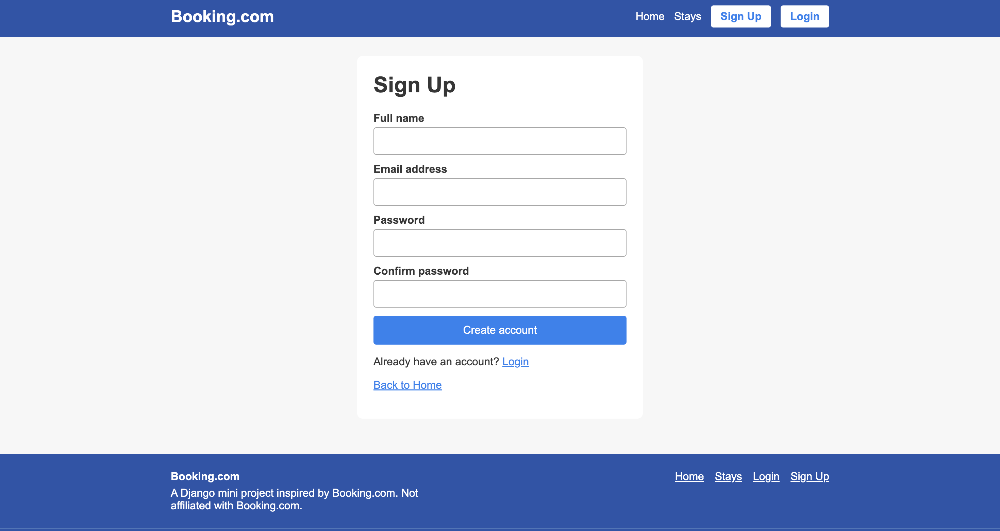

# Booking.com Clone - Django Mini Project

**Student Name / Roll Number :** Ashwin Raj 2402130002

## Project Objective
Build a simple multi-page Django website inspired by Booking.com, using templates, URL routing, views, static files and form handling.

## Website Theme / Reference
Travel website - Booking.com (stays search and property details).

## Features and Pages
| Page | URL | Name |
|---|---|---|
| Home | `/` | `home` |
| Stays (content page A) | `/stays/` | `stays` |
| Property details (content page B) | `/stays/<id>/` | `hotel_detail` |
| Login | `/login/` | `login` |
| Sign Up | `/signup/` | `signup` |

- Shared header and footer through `base.html` (template inheritance)
- Sign Up and Login use Django's built-in authentication; passwords are hashed
- Server-side validation with success and error messages; `` in every POST form

## Navigation Flow
- Home -> Stays (nav link, search bar, destination cards, "View all stays")
- Home or Stays -> click a property card -> Property details
- Header: Home, Stays, Sign Up, Login
- Login <-> Sign Up (links to each other), both link back to Home
- The Booking.com logo returns to Home from every page

## Technologies Used
Python, Django, HTML, CSS, SQLite.

## Project Structure
```
booking_simple/
├── manage.py
├── booking_clone/        (settings.py, urls.py)
└── website/
    ├── views.py
    ├── urls.py
    ├── templates/website/  (base, home, stays, hotel_detail, login, signup)
    └── static/website/css/style.css
```

## How to Run
1. `pip install -r requirements.txt`
2. `python manage.py migrate`
3. `python manage.py runserver`
4. Open `http://127.0.0.1:8000/`

## Screenshots

### Home page


### Stays page


### Property details page


### Login page


### Sign Up page


## Known Limitations / Future Improvements
Property data is fixed sample data in `views.py`, and emoji are used instead of images. There is no real booking or payment. This is a coursework project and is not affiliated with Booking.com.
